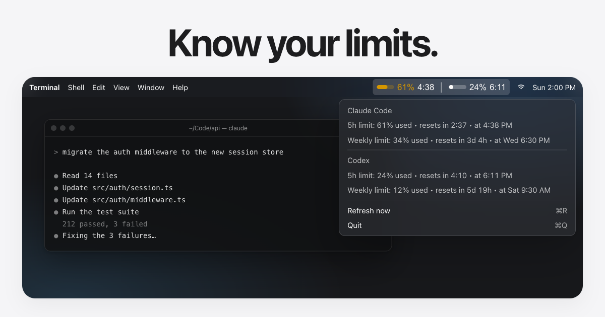

# cc-limits

Claude Code and Codex usage limits, always in your Mac's menu bar. Because the agent stopping mid-refactor is a bad way to check.

[cc-limits.morox.ai](https://cc-limits.morox.ai)



## Install

```sh
brew install morox-ai/tap/cc-limits
brew services start cc-limits
```

The formula compiles the app on your Mac, so it needs macOS 12 or newer and up-to-date Xcode Command Line Tools.

macOS may ask for keychain access on first launch. Choose "Always Allow" so the app can keep reading the credential unattended.

## What you see

The menu bar shows Claude Code on the left and Codex on the right. Each side has a progress bar, the percentage used and the reset time of the 5-hour window.

Bars stay monochrome until they matter: amber above 60%, red above 80%.

The menu adds the 7-day window for both, plus Refresh now (⌘R) and Quit (⌘Q).

A dim `∞` means that side has not loaded yet. Usually you are signed out, Codex is using an API key instead of a ChatGPT login, or keychain access has not been granted.

## What it touches

There is no account, API key or settings screen. The app reuses the credentials already on your machine.

| Service | Credential | Usage endpoint |
| --- | --- | --- |
| Claude Code | `Claude Code-credentials` in the macOS keychain | `api.anthropic.com` |
| Codex | `~/.codex/auth.json`, from `codex login` with a ChatGPT account | `chatgpt.com` |

It polls every 5 minutes and talks to nothing else. There are no analytics and no server of its own. It never refreshes the Codex token, so it uses whatever Codex last saved.

The whole app is [one Swift file](main.swift) with no dependencies. It touches your credentials, so read it first.

## Good to know

These usage endpoints are not publicly documented, so an update on their side can break the app.

This is an independent project by [Morox](https://morox.ai), not affiliated with Anthropic or OpenAI. Claude Code and Codex belong to their owners.

## Uninstall

```sh
brew services stop cc-limits
brew uninstall cc-limits
brew untap morox-ai/tap
```

## Build from source

```sh
git clone https://github.com/morox-ai/cc-limits.git
cd cc-limits
bash build.sh
open CCLimits.app
```

`build.sh` compiles `main.swift` with the system Swift toolchain and assembles `CCLimits.app` in the repository root. There is no Xcode project.

The `cc-limits` script launches that build. Use `--rebuild` to rebuild first or `--foreground` to run the app in the current terminal.

To start your own build at login, run this from the repository root:

```sh
sed "s|/Users/you/Code/cc-limits|$PWD|" ai.morox.cc-limits.plist > ~/Library/LaunchAgents/ai.morox.cc-limits.plist
launchctl load ~/Library/LaunchAgents/ai.morox.cc-limits.plist
```

To stop it, run `launchctl unload ~/Library/LaunchAgents/ai.morox.cc-limits.plist`.

If the item stays on `∞` when started this way, the keychain prompt may have had nowhere to appear. Run `open CCLimits.app` once and choose "Always Allow".

## License

[MIT](LICENSE)
